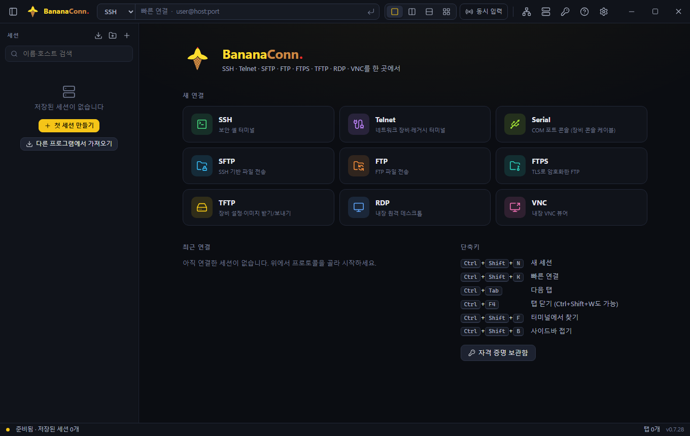

<p align="center">
  
</p>

<h1 align="center">BananaConn.</h1>

<p align="center">
  <b>An all-in-one remote access workspace for Windows.</b><br>
  SSH · Telnet · Serial · SFTP · FTP · FTPS · TFTP · RDP · VNC — in tabs and split panes, in one window.
</p>

<p align="center">
  <a href="https://github.com/NijG/bananaconn/releases/latest">Download the latest release</a> ·
  <a href="#features">Features</a> ·
  <a href="#installation">Installation</a> ·
  <a href="#building-from-source">Building from source</a> ·
  <a href="#security-model">Security model</a>
</p>

---

BananaConn. is a desktop application for people who spend their day connecting to servers and network
equipment: system administrators, network engineers and operators of data-centre and factory systems. It puts
terminals, file transfer and remote desktops side by side in one window, keeps the sessions organised in a
searchable folder tree, and adds safeguards for the commands that should never be typed by mistake.

It is written from scratch on public protocols and open-source libraries: a Rust backend
([Tauri v2](https://tauri.app/)) and a TypeScript front end ([xterm.js](https://xtermjs.org/),
[noVNC](https://novnc.com/), [CodeMirror](https://codemirror.net/)). RDP runs inside the app
([IronRDP](https://github.com/Devolutions/IronRDP)); no separate viewers are needed.

- **Platform:** Windows 10 / 11, x64
- **Interface languages:** English, 한국어, 日本語, 简体中文, 繁體中文, Tiếng Việt, Español, Français, Deutsch
  (follows the Windows display language, can be changed in Settings)
- **License:** MIT



## Contents

- [Features](#features)
  - [Protocols](#protocols)
  - [Workspace](#workspace)
  - [Sessions and import](#sessions-and-import)
  - [Terminal](#terminal)
  - [Risky command protection](#risky-command-protection)
  - [Resource monitor and device recognition](#resource-monitor-and-device-recognition)
  - [File transfer and editing](#file-transfer-and-editing)
  - [SSH gateways and tunnels](#ssh-gateways-and-tunnels)
  - [Built-in servers](#built-in-servers)
  - [Network tools](#network-tools)
- [Installation](#installation)
- [Updates](#updates)
- [Keyboard shortcuts](#keyboard-shortcuts)
- [Security model](#security-model)
- [Where data is stored](#where-data-is-stored)
- [Building from source](#building-from-source)
- [Testing](#testing)
- [Project structure](#project-structure)
- [Publishing a release](#publishing-a-release)
- [License](#license)

## Features

### Protocols

| Protocol | How it works |
| --- | --- |
| **SSH** | The Windows OpenSSH client (`ssh.exe`) runs inside a ConPTY, so host-key checks, `~/.ssh/config`, agents and keys behave exactly as on the command line. Jump hosts (`-J`), local/remote/dynamic port forwarding, compression and agent forwarding are per-session options. |
| **Telnet** | A Telnet client written in Rust: terminal type and window size negotiation, automatic login with a saved credential, and a “device keys” mode for network gear. |
| **Serial** | Direct COM port connections: baud rate, data bits, parity, stop bits, flow control and Break. Quick connect accepts `COM3:115200`. Multi-line pastes are sent line by line with a pause, and can be stopped with Ctrl+C or Break. |
| **SFTP** | A two-pane file browser on a pure-Rust SSH stack ([russh](https://github.com/Eugeny/russh)): Ed25519 and OpenSSH-format keys, host keys checked against `~/.ssh/known_hosts`, several files transferred in parallel. |
| **FTP / FTPS** | Passive and active mode, explicit (AUTH TLS) and implicit FTPS. TLS uses rustls with session resumption on data connections (which many FTPS servers require) and verifies certificates against the Windows trust store. |
| **TFTP** | Get files from a TFTP server or send them: `blksize` and `tsize` options, automatic fallback to 512-byte blocks, images larger than 65535 blocks. |
| **RDP** | A built-in remote desktop client (IronRDP, NLA/CredSSP) in a tab. The resolution follows the tab size and the Windows display scale; the clipboard works both ways for text, images, files and folders; the server certificate is pinned by its fingerprint. Optionally, a session can open in the Windows Remote Desktop client instead. |
| **VNC** | A built-in noVNC viewer reached through a local WebSocket relay, including servers that need a user name (VeNCrypt Plain, MS-Logon style). |

### Workspace

- **Tabs and split panes:** one pane, left/right, top/bottom or four panes. Drag a tab into the pane you want;
  double-click a tab to open the same session again; scroll the tab bar with the mouse wheel when it overflows.
- **Broadcast input:** type once into every connected terminal tab, including tabs that are not on screen.
  Receiving tabs blink so it is always visible where the keystrokes go.
- **Quick connect:** `user@host:port`, `[IPv6]:port` or `COM3:115200`, with the protocol picked from a list and
  recent targets remembered.
- **Status bar:** connection state, terminal size, log state, resource monitor and update notices.
- **Hidden tabs cost nothing:** tabs that are not visible stop monitoring their device and stop drawing RDP frames.
- **Themes:** 16 terminal colour themes (12 dark, 4 light); the window size and position are remembered.
- **Help:** press F1 (outside a terminal) for the built-in manual, searchable, in every interface language.

### Sessions and import

- **Session tree:** folders and sub-folders, search by name/host/user/notes, drag and drop between folders,
  duplicate, recent connections.
- **Multi-select:** Ctrl/Shift+click, Shift+arrows or Ctrl+A, then connect, edit (F2), move or delete (Del) all
  of them at once. Ctrl+C / Ctrl+V copies sessions.
- **Import from other tools:** SecureCRT (session folder or exported XML, including log settings), PuTTY and KiTTY
  (from this PC’s registry), WinSCP, Xshell, mRemoteNG (`confCons.xml`), Remote Desktop Connection Manager
  (`.rdg`), `.rdp` files and CSV. Every import is shown for review first; options that could run something
  (log file locations, port forwarding, jump hosts, drive sharing) are left out unless you allow them.
- **Backup:** export and import all sessions with their folders, snippets, macros and SSH tunnels as JSON.
  Passwords are never part of a backup.

### Terminal

- **Logging:** per-tab logs with ANSI codes, Backspace edits and line redraws removed. File names use
  substitution tokens (`%S` session, `%H` host, `%U` user, `%Y%M%D`, `%h%m%s` …), with append / overwrite /
  new-file modes, a prefix for every line, text written when logging starts and stops, and a new file at
  midnight. Defaults live in Settings; any session can override them. Logging can start automatically.
- **Snippets and macros:** save frequent commands and send them with one click, or record terminal input as a
  macro and replay it (together with broadcast input, on many servers at once). A library of ready-made commands
  for common devices is included.
- **Output highlighting:** ERROR/FAIL in red, WARN in yellow, OK/SUCCESS in green — never inside programs that
  set their own colours or use the full screen.
- **Device keys mode:** sends Ctrl-D/A/E for Delete/Home/End so that Cisco IOS and similar CLIs do not print `~`.
- **Everyday details:** find in terminal, copy on select, right-click paste, Ctrl+mouse wheel to zoom,
  GPU rendering (WebGL) when a real graphics card is present, input from remote-desktop tools that inject Unicode
  characters.

### Risky command protection

Every line sent to a terminal — typed, pasted, sent from a snippet, a macro or broadcast input — is checked
against a list of rules before it leaves the app. Rules see through `sudo`/`doas`/`su -c`/`sh -c`/`eval`,
`env VAR=…`, chained commands (`;`, `&&`, `||`, `|`, `$( )`), absolute paths and line continuations, and they
apply the effect of Backspace and Ctrl-U before matching.

- **Block** (never sent): anything that changes the system clock or time synchronisation — `date -s`,
  `timedatectl set-time`, `ntpdate`, `chronyc makestep`, `hwclock --systohc`, stopping NTP services, `w32tm /config`,
  and the NTP/clock commands of Cisco, Juniper, Huawei and FortiGate devices.
- **Warn** (asks first, then turns on the tab’s log and records the decision in an audit log): recursive or
  forced deletes, reboot and shutdown, disk formatting and raw device writes, `kill -9`, recursive permission
  changes, stopping services, removing volumes, and device commands such as `reload`, `write erase`,
  `copy … running-config` or entering configuration mode.
- Rules are regular expressions you can edit in Settings; an invalid rule is refused when saving, never silently
  ignored. Macros containing cursor-movement keys, whose final text cannot be known, are flagged.

### Resource monitor and device recognition

For SSH and Telnet sessions BananaConn. opens a second, quiet login that runs read-only commands only, and shows
CPU and memory in the status bar. Clicking it shows the top 10 processes and disk usage. All tabs of the same
device share one monitoring connection, and nothing is written to the remote shell history.

The device type is recognised automatically, which enables a menu of device-specific show commands, a
configuration backup to a `.cfg` file (refused when the output is cut short or permission is denied) and the right
key mode:

| Vendor | Systems |
| --- | --- |
| Cisco | IOS, IOS-XE, NX-OS, ASA |
| Juniper | Junos |
| Huawei | VRP |
| Fortinet | FortiGate (FortiOS) |
| Aruba | AOS-CX, AOS-Switch, Mobility Controller |
| Linux | RHEL, Rocky, Ubuntu and other distributions |
| IBM / HPE / Oracle | AIX, HP-UX, Solaris |

The monitor never sends a user name without a password (which a device would log as a failed login), stops at
one-time-code and yes/no prompts instead of answering them, and pauses while none of its tabs is visible.

### File transfer and editing

- Two panes (local and remote) with multi-select, recursive folder transfer, progress and cancel, drag and drop
  between panes, name filter, hidden files and overwrite confirmation.
- **Safe transfers:** downloads are written under a temporary name and renamed when complete; uploads go to a
  temporary name on the server and replace the file at the end. Cancelling or losing the connection never leaves
  a truncated file behind.
- **Built-in editor:** double-click a remote text file to edit it in the app (syntax highlighting, find and
  replace). Line endings and UTF-8 BOM are preserved, and if the file changed on the server since it was opened,
  you are asked before it is overwritten.
- **Open with an external app:** the file opens in its Windows default app and is uploaded again on save.
  Executables and scripts (`.exe`, `.bat`, `.js`, `.ps1`, …) are never opened this way, because opening them would
  run them.
- **SFTP next to SSH:** open the same server’s files beside a terminal with one click, or automatically for every
  SSH connection.

### SSH gateways and tunnels

- **SSH gateway:** RDP, VNC and Telnet sessions can reach equipment behind a firewall through a saved SSH session.
  The forwarding happens inside the app; `ssh.exe` is not involved.
- **SSH tunnel manager:** save local-port → SSH server → target forwardings and switch them on and off.
- Host keys are checked like everywhere else; an unknown key shows its fingerprint and must be confirmed.

### Built-in servers

Share a folder of this PC for a moment — for a firmware upgrade or a configuration backup — without installing
anything else. Clients can never leave the shared folder.

- **FTP server:** read-only or read-write, anonymous access optional, LAN access optional (Windows Firewall asks the
  first time), generated one-time passwords, an activity log of logins and transfers, and a 5-minute block after 5
  failed logins. Passive data ports 50000–50100. FTP is unencrypted: use it only on networks you trust.
- **TFTP server:** for network equipment; read-only by default.
- **HTTP server:** read-only downloads from a browser, optional basic authentication.

### Network tools

Ping (stoppable at any time), TCP port check of several ports and ranges at once, and DNS lookup — from the
Tools menu, without opening a terminal.

## Installation

1. Download the installer from the [latest release](https://github.com/NijG/bananaconn/releases/latest):
   - `BananaConn_<version>_x64-setup.exe` — per-user install, no administrator rights needed (recommended);
   - `BananaConn_<version>_x64_en-US.msi` — per-machine install for managed deployment.
2. Run it. Windows SmartScreen may warn about an unrecognised app the first time; choose **More info → Run anyway**.
3. Start **BananaConn** from the Start menu.

Requirements: Windows 10 or 11 (x64) with the Microsoft Edge WebView2 runtime (included in current Windows).
SSH sessions use the Windows OpenSSH client (*Settings → System → Optional features → OpenSSH Client*), which is
installed by default on current Windows.

Installing over an earlier version keeps all sessions, settings and saved passwords. Copies installed under the
project’s previous names are removed by the installer, and their data is moved over on first start.

## Updates

BananaConn. checks for a new version at startup, every 30 minutes and whenever you ask
(*Settings → Updates → Check now*), and offers to install it. It looks in this order:

1. this repository’s latest release (`https://github.com/NijG/bananaconn/releases/latest/download/`);
2. the NAS update folder set in Settings — for PCs whose security policy blocks GitHub.

Every release carries a `latest.json` manifest signed with an Ed25519 key that exists only on the build machine.
The app installs a version only when the signature is valid and the installer’s SHA-256 matches the manifest, so a
file placed in the share or the download location by anyone else is never installed. Downloads go through Windows
(WinHTTP), so the system proxy and certificate store are used.

## Keyboard shortcuts

Every shortcut can be changed in **Settings → Keyboard shortcuts**: change, add or remove keys, give a key to actions
that have none (layouts, n-th tab, duplicate tab, reconnect, logging, clear screen, font size …) or to any snippet or
macro, and restore the defaults per action or all at once. A key already in use is reported before it is moved, and
shortcuts match the physical key, so they also work with an input method such as Korean switched on. The defaults:

| Keys | Action |
| --- | --- |
| `Ctrl+Shift+N` | New session |
| `Ctrl+Shift+K` | Quick connect |
| `Ctrl+Tab` / `Ctrl+Shift+Tab` | Next / previous tab |
| `Ctrl+F4` · `Ctrl+Shift+W` | Close tab |
| `Ctrl+Shift+F` | Find in terminal |
| `Ctrl+Shift+B` | Show / hide the sidebar |
| `Ctrl+C` (with a selection) / `Ctrl+V` | Copy / paste |
| `Ctrl` + mouse wheel | Terminal font size |
| `F1` | Help (inside a terminal, F1 goes to the remote program) |
| File browser: `F5` `F2` `Del` `Backspace` `Enter` `Ctrl+A` | Refresh / rename / delete / parent folder / open / select all |
| Session tree: `Enter` `F2` `Del` `Ctrl+A` | Connect / edit / delete / select all |

## Security model

- **Secrets stay in Windows.** Passwords and key passphrases are stored in the Windows Credential Manager, never
  in BananaConn.’s own files. They are used by the backend only and are not sent to the user interface (the one
  exception is VNC, whose viewer runs in the interface).
- **Master password (optional).** Locks the app at start and after inactivity; while locked, the backend refuses
  to use any saved secret. Only a PBKDF2-SHA256 hash is stored.
- **Host keys and certificates.** SSH/SFTP host keys are checked against `~/.ssh/known_hosts`; unknown keys are
  shown with their fingerprint before they are trusted, and a changed key blocks the connection. RDP server
  certificates are pinned by fingerprint. FTPS certificates are verified against the Windows trust store.
- **The RDP client runs in its own process** (`bx-rdp.exe`). Connection details reach it through standard input,
  never on the command line, and a crash in the RDP decoder cannot take the app down. The process is bound to the
  app with a Windows job object, so it never outlives it.
- **Imports and backups are untrusted input.** Options that could write files or open connections are shown and
  left out unless you allow them; log files can never be given an executable extension.
- **Signed updates.** See [Updates](#updates).
- **Local only.** BananaConn. has no account, no telemetry and no cloud service. It connects only to the hosts you
  choose and to the update locations above.

## Where data is stored

| What | Where |
| --- | --- |
| Sessions, settings, credential list (no secrets) | `%APPDATA%\com.administrator.bananaconn\` |
| Window state, interface storage | `%LOCALAPPDATA%\com.administrator.bananaconn\` |
| Passwords and passphrases | Windows Credential Manager, entries ending in `.BananaConn` |
| Logs and the risky-command audit log | `Documents\BananaConn\logs\` (or the folder set in Settings) |
| Temporary files (edits, downloads, update installers) | `%TEMP%\BananaConn\` |

Uninstalling from *Settings → Apps* removes the program; sessions and logs stay unless you delete the folders above.

## Building from source

Requirements:

- Windows 10/11 x64
- [Node.js](https://nodejs.org/) 24 or later
- [Rust](https://rustup.rs/) (stable, MSVC toolchain) with the Visual Studio C++ build tools
- The WebView2 runtime (included in current Windows)

```bash
git clone https://github.com/NijG/bananaconn.git
cd bananaconn
npm install
npm run tauri dev      # development build with hot reload
npm run tauri build    # release build + NSIS and MSI installers in src-tauri/target/release/bundle
npm run dev            # user interface only, in a browser, with a simulated backend
```

The RDP client (`rdp-helper/`) is built automatically by `npm run build:rdp` before `tauri dev` and `tauri build`,
and placed in `src-tauri/binaries/`.

## Testing

```bash
npx tsc --noEmit -p .                    # type check
node scripts/i18n-check.mjs              # every interface text translated in all 9 languages
cd src-tauri
cargo test --lib                         # unit tests
cargo test --lib -- --include-ignored    # also tests against public servers (needs internet access)
```

## Project structure

```
src/                     TypeScript front end (Vite)
  main.ts                app assembly, menus, shortcuts
  workspace.ts           tabs, split panes, broadcast input
  sidebar.ts             session tree
  views/                 terminal (xterm.js), files, editor (CodeMirror), RDP, VNC (noVNC), TFTP
  riskRules.ts           risky command rules and the line parser
  importers.ts           importers for other tools' session formats
  i18n/, help/           interface translations and the built-in manual
src-tauri/src/           Rust backend (Tauri v2)
  term.rs, telnet.rs     SSH (ConPTY), Telnet and serial sessions, logging
  remote.rs              SFTP, FTP, FTPS, local files, transfers
  devmon.rs, monitor.rs  resource monitor and device recognition
  tunnel.rs              SSH gateways and port forwarding
  ftpserver.rs, fileservers.rs   built-in FTP, TFTP and HTTP servers
  vault.rs, lock.rs      Credential Manager storage, master password
  updater.rs             signed updates from GitHub Releases or a share
rdp-helper/              the RDP client process (IronRDP)
design/                  logo source (SVG) and icon generation scripts
```

Two libraries are used with small local patches, kept in `src-tauri/vendor/` and `rdp-helper/vendor/`; each has
a `BANANACONN_PATCH.md` describing the change, and the patches are dropped as soon as upstream releases include
the fixes.

## Publishing a release

On the build machine, with the update signing key:

```bash
npx tauri build
node scripts/publish-github.mjs NijG/bananaconn notes.txt         # GitHub release + signed latest.json
node scripts/publish-update.mjs \\server\share\updates notes.txt  # optional: the same release to a share
```

`notes.txt` holds the release notes; translations sit next to it as `notes.<language>.txt`, and the GitHub release
page shows `notes.en.txt`. The signing key is read from the file named by `BX_UPDATE_KEY` and never leaves the build
machine.

### Your own builds

The app installs only updates signed with the key whose public half is `PUBLIC_KEY` in `src-tauri/src/updater.rs`.
To publish your own builds, create a new Ed25519 key pair, keep the private key outside the repository (point
`BX_UPDATE_KEY` at it), put the public key into `PUBLIC_KEY`, and set `UPDATE_URL` in `src/store.ts` to your own
release address. The update folder in Settings has no default in this source.

## License

BananaConn. is released under the [MIT License](LICENSE). Third-party components keep their own licenses; see
[THIRD_PARTY_NOTICES.md](THIRD_PARTY_NOTICES.md).
